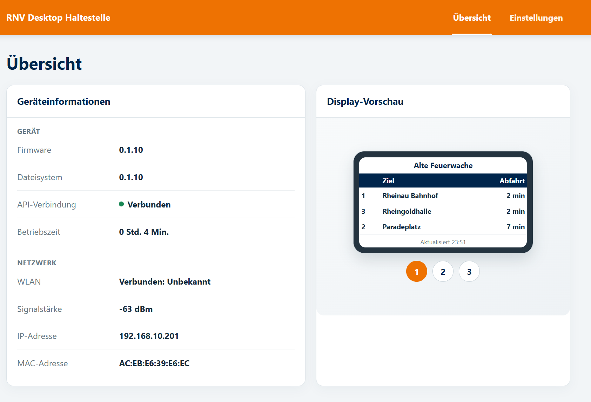
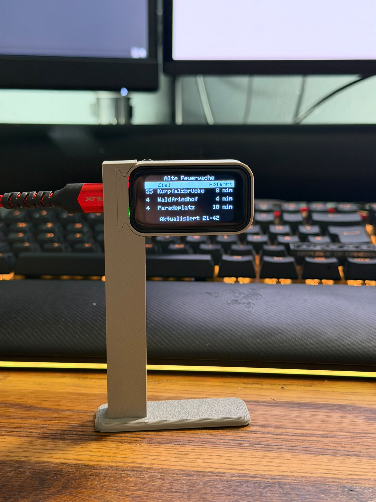

# RNV Table Station

RNV Table Station is a compact departure display for RNV stops. It shows the next three departures for a selected stop on a 172 × 320 color screen and refreshes the information every 20 seconds.

Use the built-in web interface to connect the device to Wi-Fi, choose stops, preview departures, and manage the display. You can configure three stop slots and choose which one appears on the screen after startup. The interface also includes a stop search, map, screen brightness control, and firmware update options.

## Set up the device

1. Power on the device. If it has not been connected to Wi-Fi, the screen shows a QR code for its setup network.
2. Scan the QR code with a phone or connect manually to the open Wi-Fi network **RNV-Haltestelle**. If your phone says the network has no internet access, choose to remain connected.
3. Once connected, use the address shown on the device's screen to open the setup page in a browser. It is usually `http://192.168.4.1`.
4. Enter the name and password of the Wi-Fi network the device should use, then save. The device restarts and connects to that network.
5. Find the device's IP address in your router's connected-device list, then open that address in a browser.
6. In the web interface, select up to three stops and choose the default slot. Save your settings; the device restarts and displays departures for the selected default stop.

If the device cannot connect to its saved Wi-Fi network, it starts the **RNV-Haltestelle** setup network again so you can update the Wi-Fi settings.

## Using the web interface

- **Preview:** Switch between the three configured stop slots and view current departures.
- **Stops:** Search the RNV stop catalogue or use the map to select stops.
- **Default slot:** Choose which configured stop appears on the device screen after startup.
- **Device settings:** Change the device name, screen brightness, and whether screen colors are inverted. The display uses at most half the configured brightness (up to 50%) and dims to 30% after one minute without touch; touching the screen restores the configured level and restarts the timer.
- **Updates:** Install firmware and filesystem updates from their respective update fields.
- **Reset:** Erase saved settings, including Wi-Fi credentials, and return the device to first-time setup.

The departure display needs an internet connection to retrieve live schedule information. The map also needs internet access; stop search uses the catalogue stored on the device.

The setup and management pages are available to devices on the same Wi-Fi network and do not require a password. Use the device on a trusted network.
